<div align="center">

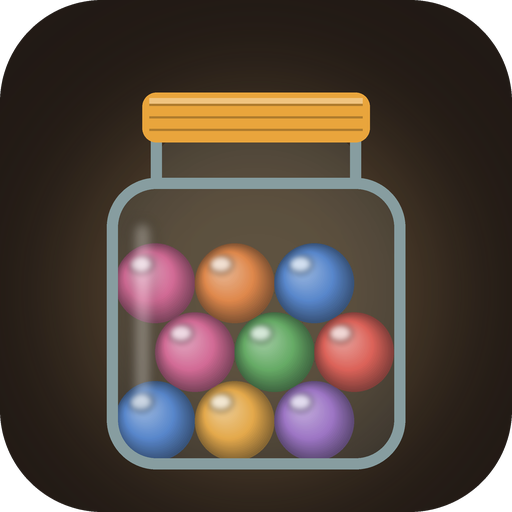

# Marbles

### About 940 Saturdays. Spend them together.

*A jar holding one marble for every Saturday until your child turns eighteen. Every week one leaves the jar, coloured if you spent time together and grey if you didn't. Next to it is an honest mirror: the evening's minutes on the phone beside the minutes with the children. Free, no ads, no account, no internet permission.*

[](https://github.com/bigdevwhale/marbles/actions/workflows/android.yml)
[](https://github.com/bigdevwhale/marbles/releases/latest)


[](LICENSE)

**English** · [Русский](README.ru.md) · [Changelog](CHANGELOG.md)

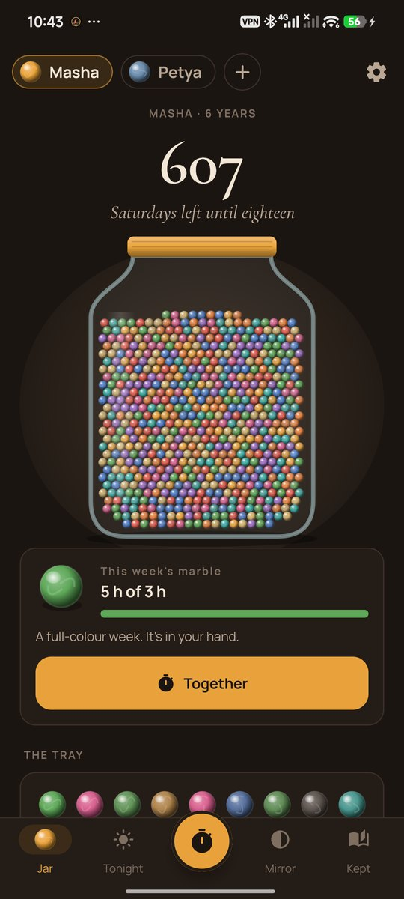 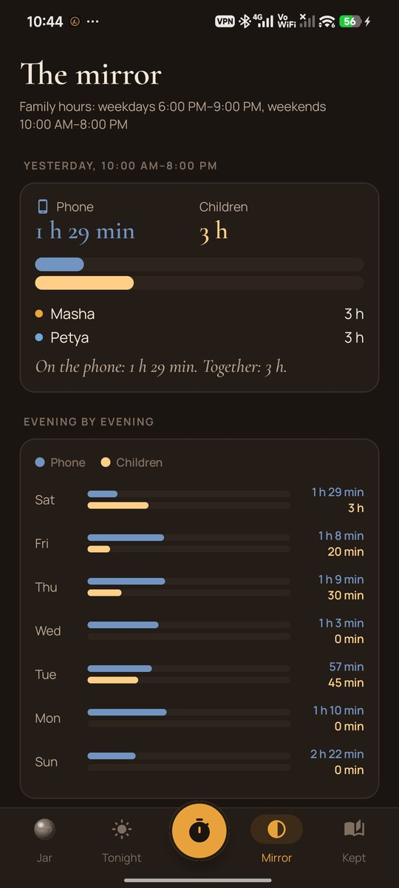 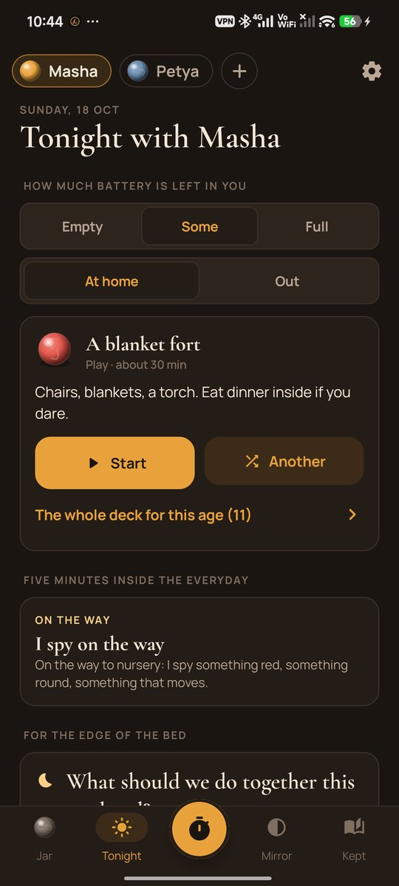 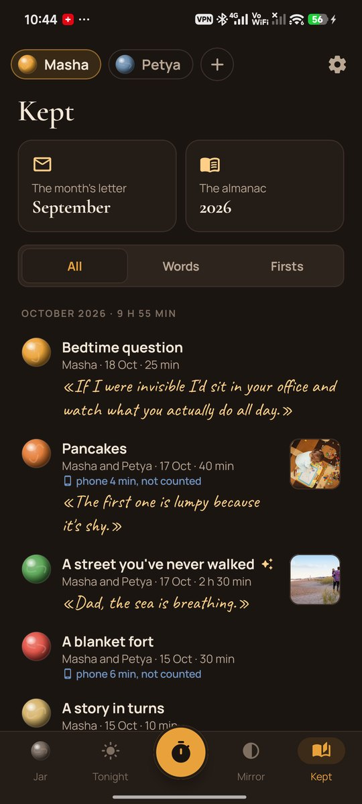

</div>

---

## The idea

There's an old story about a man who worked out he had about a thousand Saturdays left. He bought a thousand marbles and took one out of the jar every week. A childhood holds about 940 of them. Most parents don't need to be told to love their children. What they need is a nudge at seven in the evening, when the phone is in their hand and the child is in the next room.

Marbles is for the parent. It shows how many Saturdays are left and tells you plainly where the evenings went. When you're too tired to think of anything, it gives you something to do in the next ten minutes.

## How it works

1. **Open a jar** for each child: a name, a birthday, a colour.
2. **Put the phone away.** Tap the button in the middle, put the phone face down and go. When you finish, the phone's own usage history says how long you picked it up meanwhile, and those minutes don't count. Glances under 30 seconds are ignored.
3. **Keep something.** A picture taken with your phone's own camera, what they said, whether it was a first.

## What's inside

| | Feature | How it works |
|---|---|---|
| 🫙 | **The jar** | Every Saturday until eighteen as a marble. Each week's marble fills with colour as the time together adds up, in the colour of what you did most: play, outside, books, kitchen, talk… On Sunday night it goes into the tray, bright or grey. |
| 🪞 | **The honest mirror** | Within your family hours, two lines for every evening: the phone and the children. Evening by evening, this week against the last, and the apps that took the evenings. No scores and no advice. |
| 🛡️ | **The shield** | Optional. When the phone takes 10 minutes of a quarter hour in the family hours, a quiet notification with a child's name: "Masha is right here." At most once in 45 minutes. |
| 🔋 | **Ideas by battery** | Tell it how much you have left: empty, some or full; at home or out. An empty battery gets ideas you can do lying down: doctor and patient, drawing on a back, "tell *me* a story". A deck of 60 ideas, filtered by age. |
| ⏱️ | **Five minutes inside the everyday** | Rituals for the way to school, dinner, the bath and bedtime, so the routine becomes time together. |
| 🌙 | **For the edge of the bed** | 40 questions that open a child up better than "how was school?". Their answers are kept in their words. |
| 💡 | **What they're into now** | Dinosaurs, a friend called Sonya, afraid of the hoover. A reminder once a month to update it, "Ask about: horses" in the evening, and a list of what they were into before. |
| 👧👦 | **One on one** | With brothers and sisters around, children talk differently. Marbles shows who hasn't had you to themselves for a while and helps plan it. |
| 📅 | **Plans** | On Thursday: what are you doing on Saturday? A Saturday with a plan doesn't slip by. |
| 📖 | **What matters at this age** | A short note a week, by age: the age of "why", the last easy years before the teens, side by side rather than face to face. |
| ✉️ | **The month's letter** | On the 1st: days together, hours, what they said, the firsts, the pictures, the mirror's month. |
| 📕 | **The almanac** | A month or a year as a small printable book (A5 PDF). |
| 🔔 | **Gentle reminders** | One idea for the evening, around when you usually get home (learned from your own evenings). No streaks and no guilt: a missed week is a grey marble and "It happens." |
| 💾 | **Backup** | Everything, pictures included, in one zip. |

## Privacy

There is no account, no cloud, no analytics and no internet permission. The mirror reads the phone's usage history only with your "usage access", and keeps nothing but minutes per app for each evening, on the phone. Pictures are taken by your phone's own camera app and copied into the app's storage.

## Screenshots

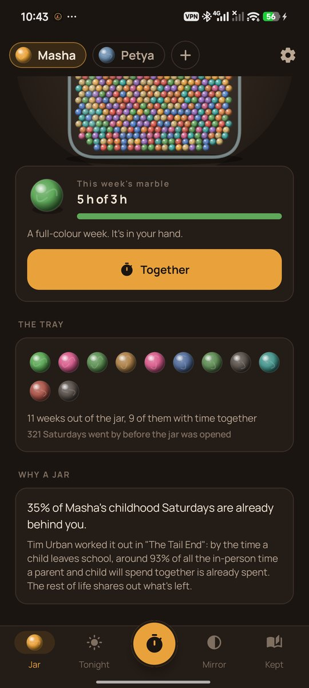 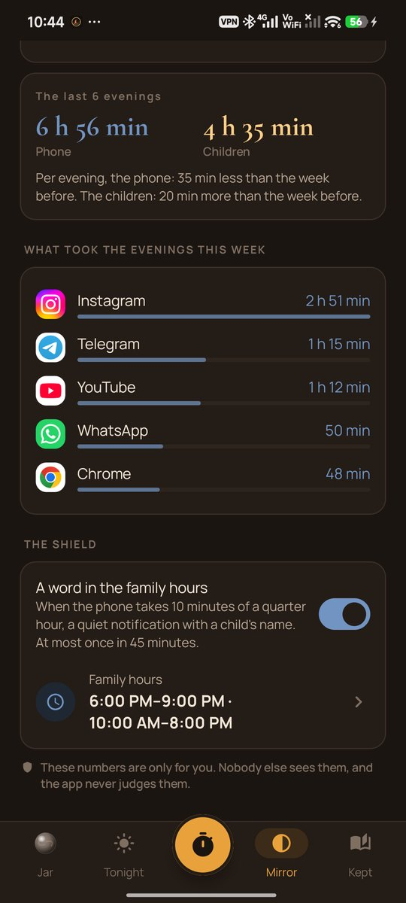 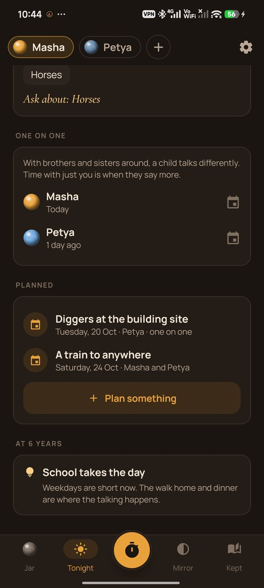 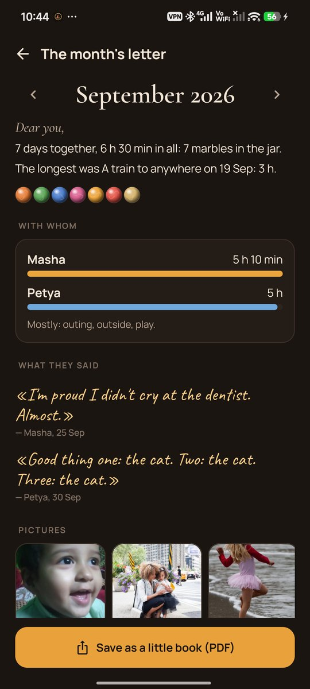 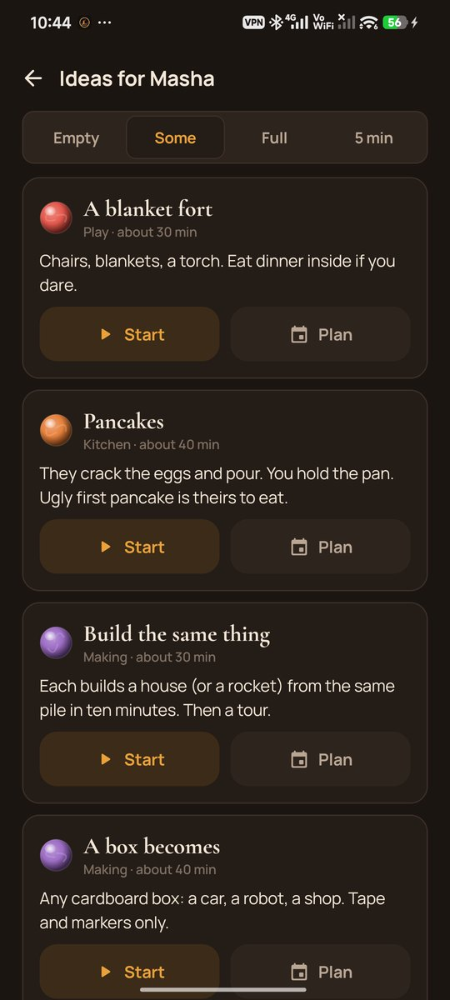 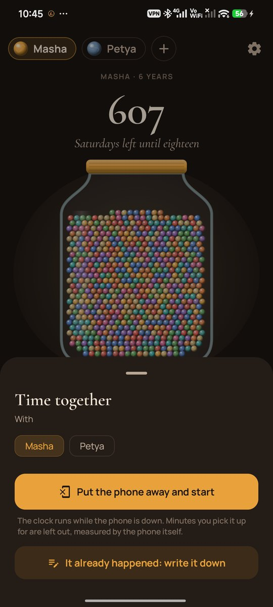

## Build

```bash
./gradlew assembleDebug             # app.marbles.dev
./gradlew assembleDebug -Pdemo      # app.marbles.demo, a made-up family for screenshots
./gradlew testDebugUnitTest         # unit tests
./gradlew testDebugUnitTest -Prender --tests '*Render*'   # the screens to app/build/art
```

Kotlin, Jetpack Compose, Room, DataStore. The mirror uses `UsageStatsManager` events. The jar is drawn on a Compose canvas, and the almanac uses Android's `PdfDocument`.

Demo photos (demo build only) are from Wikimedia Commons and Unsplash; see [docs/demo-credits.txt](docs/demo-credits.txt). The 93% figure is from Tim Urban's essay [The Tail End](https://waitbutwhy.com/2015/12/the-tail-end.html).

Part of [Stillcraft](https://bigdevwhale.github.io/stillcraft/). MIT licence.
