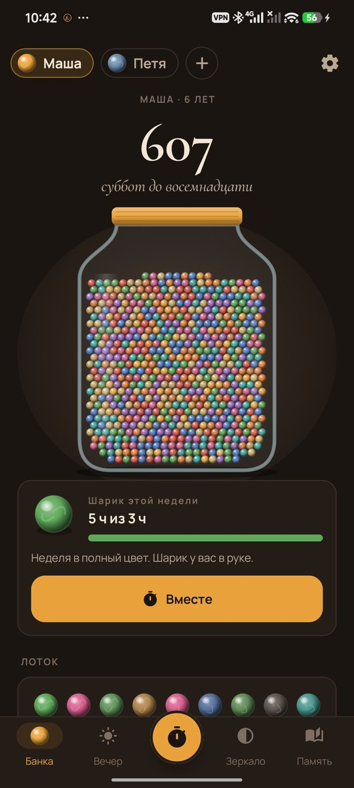
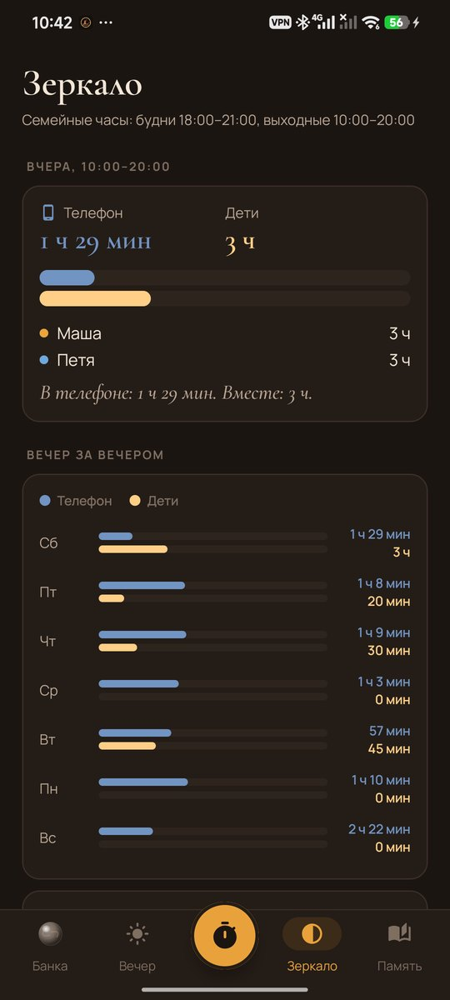
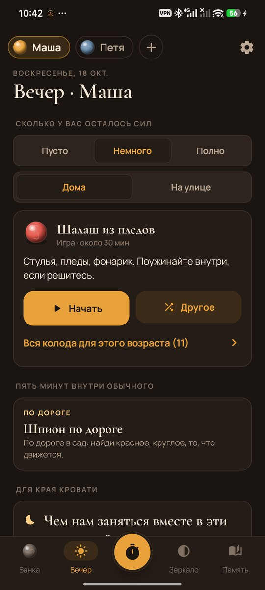
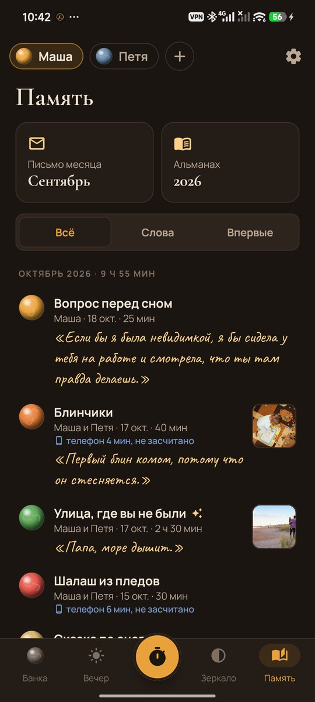
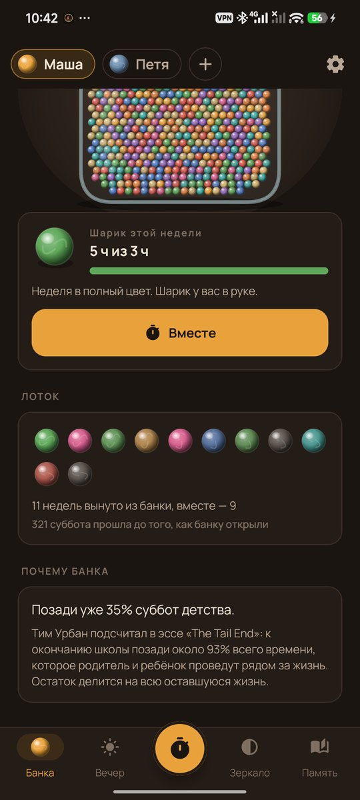
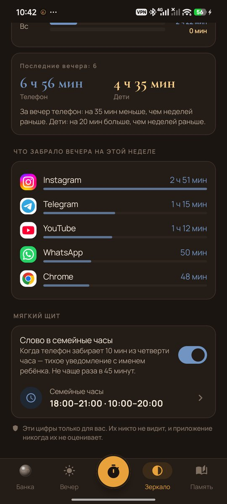
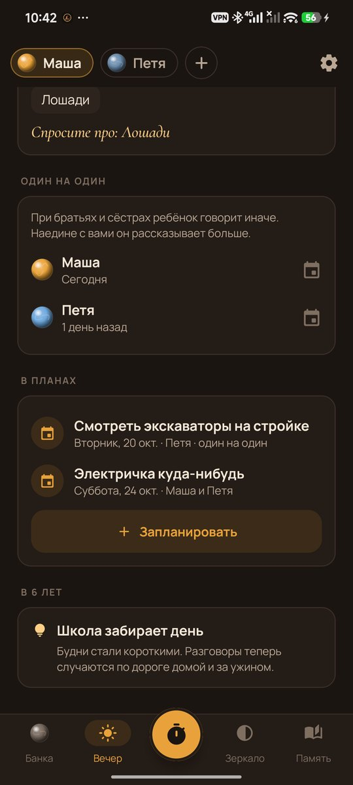
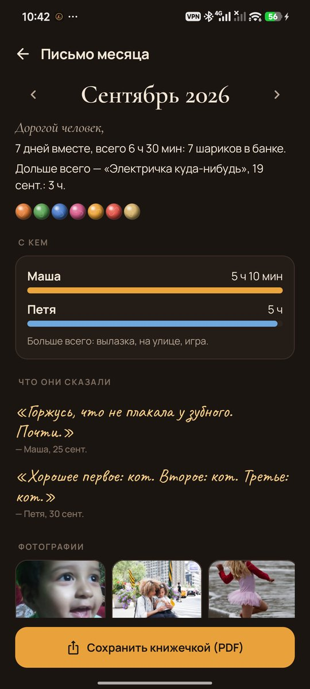
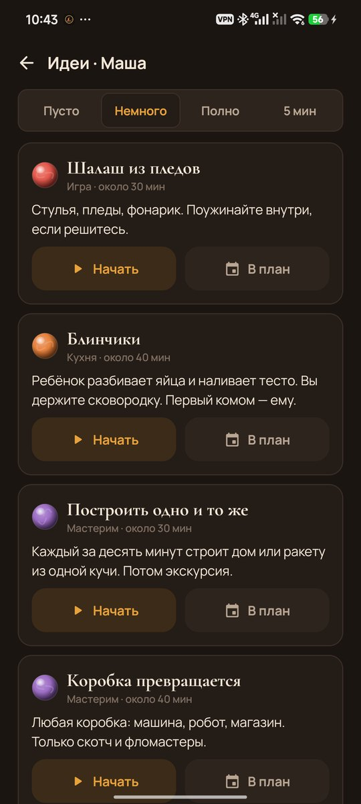
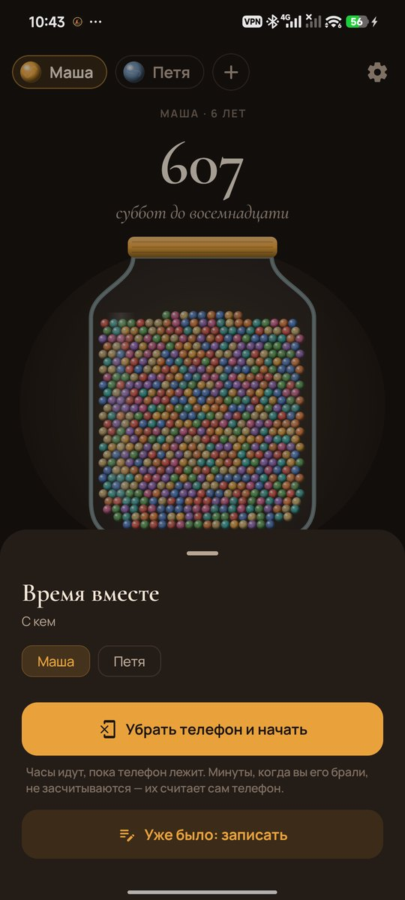

# Marbles

### Около 940 суббот. Проведите их вместе.

*Банка, в которой по шарику на каждую субботу, пока ребёнку не исполнится восемнадцать. Каждую неделю один шарик уходит: цветной, если вы провели время вместе, или серый, если нет. Рядом честное зеркало: минуты вечера в телефоне рядом с минутами с детьми. Бесплатно, без рекламы, без аккаунта, без доступа в интернет.*

[English](README.md) · **Русский** · [Изменения](CHANGELOG.md)

   

---

## Идея

Есть старая история про человека, который подсчитал, что у него осталось около тысячи суббот. Он купил тысячу шариков и каждую неделю вынимал из банки один. В детстве около 940 суббот. Большинству родителей не нужно объяснять, что детей надо любить. Им нужен толчок в семь вечера, когда телефон в руке, а ребёнок в соседней комнате.

Marbles сделан для родителя. Он показывает, сколько суббот осталось, и прямо говорит, куда ушли вечера. А когда сил придумывать нет, подсказывает, чем заняться в ближайшие десять минут.

## Как это работает

1. **Откройте банку** для каждого ребёнка: имя, день рождения, цвет.
2. **Уберите телефон.** Нажмите кнопку в центре, положите телефон экраном вниз и идите. Когда закончите, история использования самого телефона покажет, сколько вы его брали, и эти минуты не засчитаются. Взгляды короче 30 секунд не считаются.
3. **Сохраните что-то.** Фотографию с камеры телефона, то, что сказал ребёнок, отметку «впервые».

## Что внутри

| | Что | Как |
|---|---|---|
| 🫙 | **Банка** | Каждая суббота до восемнадцати — шарик. Шарик недели наливается цветом по мере того, как набирается время вместе, и красится в цвет того, чем вы занимались больше всего. В воскресенье вечером он ложится в лоток, яркий или серый. |
| 🪞 | **Честное зеркало** | В семейные часы две полоски за каждый вечер: телефон и дети. Вечер за вечером, эта неделя против прошлой и приложения, которые забрали вечера. Без оценок и советов. |
| 🛡️ | **Мягкий щит** | По желанию. Когда телефон забирает 10 минут из четверти часа в семейные часы, приходит тихое уведомление с именем ребёнка: «Маша рядом». Не чаще раза в 45 минут. |
| 🔋 | **Идеи по заряду** | Скажите, сколько у вас осталось сил (пусто, немного, полно) и где вы, дома или на улице. При пустой батарейке предлагаются идеи, которые можно делать лёжа: доктор и пациент, рисунок на спине, «расскажи *мне* сказку». В колоде 60 идей, они подбираются по возрасту. |
| ⏱️ | **Пять минут внутри обычного** | Ритуалы для дороги в школу, ужина, ванны и отхода ко сну, чтобы рутина стала временем вместе. |
| 🌙 | **Для края кровати** | 40 вопросов, на которые ребёнок ответит охотнее, чем на «как в школе?». Ответы сохраняются его словами. |
| 💡 | **Чем увлечён сейчас** | Динозавры, подружка Соня, боится пылесоса. Раз в месяц приходит напоминание обновить список, вечером подсказка «Спросите про: лошадей», а прежние увлечения хранятся отдельно. |
| 👧👦 | **Один на один** | При братьях и сёстрах дети говорят иначе. Marbles показывает, кто давно не был с вами наедине, и помогает это запланировать. |
| 📅 | **Планы** | В четверг: что делаете в субботу? Суббота с планом не проходит мимо. |
| 📖 | **Что важно в этом возрасте** | Короткая заметка раз в неделю по возрасту: возраст «почему», последние лёгкие годы перед подростковым, разговоры плечом к плечу, а не лицом к лицу. |
| ✉️ | **Письмо месяца** | Первого числа: дни вместе, часы, что говорили дети, «впервые», фотографии, месяц в зеркале. |
| 📕 | **Альманах** | Месяц или год в виде маленькой книжки для печати (PDF формата A5). |
| 🔔 | **Мягкие напоминания** | Одна идея на вечер, примерно когда вы приходите домой (время подстраивается под ваши вечера). Никаких серий и чувства вины: пропущенная неделя — это серый шарик и «Бывает». |
| 💾 | **Резервная копия** | Всё, включая фотографии, в одном zip. |

## Приватность

Нет ни аккаунта, ни облака, ни аналитики, ни доступа в интернет. Зеркало читает историю использования телефона только с вашего «доступа к истории использования» и хранит лишь минуты по приложениям за каждый вечер, на телефоне. Фотографии снимает камера самого телефона, копии хранятся в приложении.

## Скриншоты

     

Часть [Stillcraft](https://bigdevwhale.github.io/stillcraft/). Лицензия MIT.
